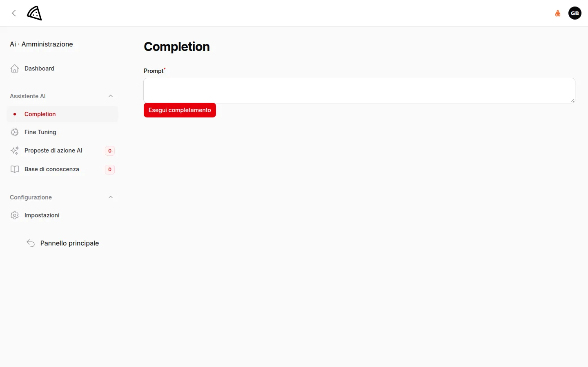

# AI

  <strong>Laravel module</strong> 
  <a href="https://github.com/laraxot/module_ai_fila5"><code>laraxot/module_ai_fila5</code></a>

 
 
 

> Reusable AI capabilities for Laravel applications in the Laraxot ecosystem.

AI è un pacchetto indipendente e riusabile: non contiene assunzioni su un singolo prodotto, ente o progetto. Il progetto ospitante fornisce configurazione, branding, contenuti e integrazioni specifiche.

## Per iniziare

- [README del repository](https://github.com/laraxot/module_ai_fila5)
- [Documentazione](https://github.com/laraxot/module_ai_fila5/tree/dev/docs)
- [ADR](https://github.com/laraxot/module_ai_fila5/tree/dev/docs/adr) · [Contratti](https://github.com/laraxot/module_ai_fila5/tree/dev/docs/contracts)
- [Issue](https://github.com/laraxot/module_ai_fila5/issues) · [Discussions](https://github.com/laraxot/module_ai_fila5/discussions)

## Regia GitHub — acquisizione B2B (BMAD + ECC + Second Brain)

- [Epic prospecting #32](https://github.com/laraxot/module_ai_fila5/issues/32) con story prioritarie [#33](https://github.com/laraxot/module_ai_fila5/issues/33)–[#41](https://github.com/laraxot/module_ai_fila5/issues/41).
- [Mappa operativa di tutte le superfici GitHub](https://github.com/laraxot/module_ai_fila5/blob/dev/docs/github-ops/00-index.md): Issue Views, Projects, Milestones, Labels, PR, Agents, Discussions, Actions, Wiki, Security, Insights, Settings.
- [PRD](https://github.com/laraxot/module_ai_fila5/blob/dev/docs/prd.md) · [Roadmap](https://github.com/laraxot/module_ai_fila5/blob/dev/docs/roadmap/README.md) · [Studio Closer/Sellbird](https://github.com/laraxot/module_ai_fila5/blob/dev/docs/prompts/clients.md) · [Second Brain](https://github.com/laraxot/module_ai_fila5/blob/dev/docs/wiki/concepts/second-brain-local-discipline.md).
- Profili GitHub Copilot custom (richiedono selezione manuale): [BMAD Architect](agents/prospect-bmad-architect.agent.md), [ECC Reviewer](agents/prospect-ecc-reviewer.agent.md), [Second Brain Curator](agents/prospect-second-brain.agent.md). La presenza del file non garantisce che l'account abbia attivato gli agenti.

**Guardrail:** il modulo AI non invia email di marketing, non accede a dati privati per prospecting e non decide regole del CRM del progetto host. Prima di una release: P0 privacy/security e test PHPStan/Pest sul progetto ospitante.

## Manuali

- [manuale utente](https://github.com/laraxot/module_ai_fila5/blob/dev/docs/manuals/manuale-utente.md)

## Collaborare

Sviluppo sul branch `dev`; apri una issue riproducibile o una proposta, collega la pull request all'issue e mantieni la documentazione vicino al codice owner. Prima di inviare una modifica esegui i test del progetto ospitante, PHPStan/Pint quando disponibili e il controllo dei link/documenti.

- [Actions](https://github.com/laraxot/module_ai_fila5/actions) · [Milestones](https://github.com/laraxot/module_ai_fila5/milestones) · [Labels](https://github.com/laraxot/module_ai_fila5/labels)
- [Security](https://github.com/laraxot/module_ai_fila5/security) per segnalazioni private
- [Wiki](https://github.com/laraxot/module_ai_fila5/wiki)

> Le guide descrivono capacità riusabili; URL, ruoli e flussi effettivi possono essere ridefiniti dall'applicazione che installa il pacchetto.
