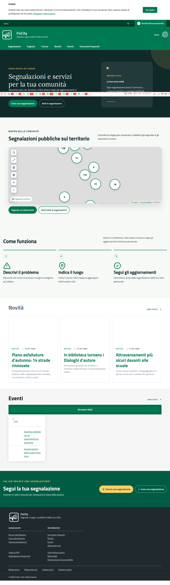

> Screenshot reale del front office FixCity, verificato il 23 novembre 2026. Per questo modulo è una superficie condivisa: il manuale non attribuisce al modulo una UI propria se non documentata dalle fonti.

# Manuale d'uso per attori

## Scopo

AI fornisce integrazioni AI, agenti, thread di conversazione e pagine Filament per completion e analisi del sentiment. Il pannello del modulo e' `AI/admin`; le impostazioni del tenant sono documentate come riservate al super-admin.

## Attori e capacita'

| Attore | Capacita' verificata | Verifica |
|---|---|---|
| Ospite | N/A verificato | `Completion::getUser()` richiede un utente autenticato. |
| Utente normale autenticato | Puo' usare le funzioni della pagina Completion solo se ammesso al pannello Filament; puo' operare soltanto sul proprio prefisso thread quando usa l'agent. | [Completion.php](../app/Filament/Pages/Completion.php#L81-L93); [StreamAgentRunActionTest.php](../tests/Unit/Agent/StreamAgentRunActionTest.php#L33-L59). Non e' verificato un ruolo specifico per l'accesso al pannello. |
| Utente in gruppo/ruolo | N/A verificato come capacita' autonoma: AI non definisce nei riferimenti consultati una matrice di ruoli applicativi. | [AIConfigData.php](../app/Datas/AIConfigData.php#L14-L24). |
| Admin | N/A verificato per capacita' AI aggiuntive; l'accesso al pannello dipende dalla configurazione comune Filament. | [AdminPanelProvider.php](../app/Providers/Filament/AdminPanelProvider.php#L9-L12). |
| Super-admin | Puo' modificare le impostazioni AI del tenant, secondo il contratto documentato; non e' verificata una capacita' diversa per Completion. | [AIConfigData.php](../app/Datas/AIConfigData.php#L14-L24). |
| Operatore/moderatore | N/A verificato. | Nessuna policy o permesso AI dedicato trovato nelle fonti owner. |

## Flussi principali

1. Un utente autenticato apre la Completion nel pannello Filament e inserisce un prompt.
2. La pagina invoca `CompletionAction` oppure `SentimentAction` e invia il risultato all'interfaccia.
3. Un agent riceve un thread con prefisso assegnato dal chiamante: un thread di un altro utente viene rifiutato.
4. Le impostazioni AI vengono gestite dalla pagina impostazioni riservata al super-admin.

## Prerequisiti

- Modulo AI abilitato e pannello Filament registrato.
- Autenticazione Filament per le pagine che usano `Filament::auth()->user()`.
- Configurazione dei provider/chiavi AI richiesta dall'operazione; le chiavi restano nell'ambiente, non nel manuale.
- Thread agentico e prefisso coerenti con l'utente chiamante.

## Limiti e casi non supportati

- Non e' verificato l'uso delle pagine AI da ospiti.
- Non e' verificata un'autorizzazione AI basata su gruppo, ruolo `admin` o ruolo operatore.
- Un thread con prefisso di un altro utente e' negato; un turno senza messaggio utente o decisione e' rifiutato.

## Riferimenti owner

- [README](README.md)
- [agents](agents.md)
- [AdminPanelProvider](../app/Providers/Filament/AdminPanelProvider.php)
- [Completion](../app/Filament/Pages/Completion.php)
- [test degli agent](../tests/Unit/Agent/StreamAgentRunActionTest.php)

