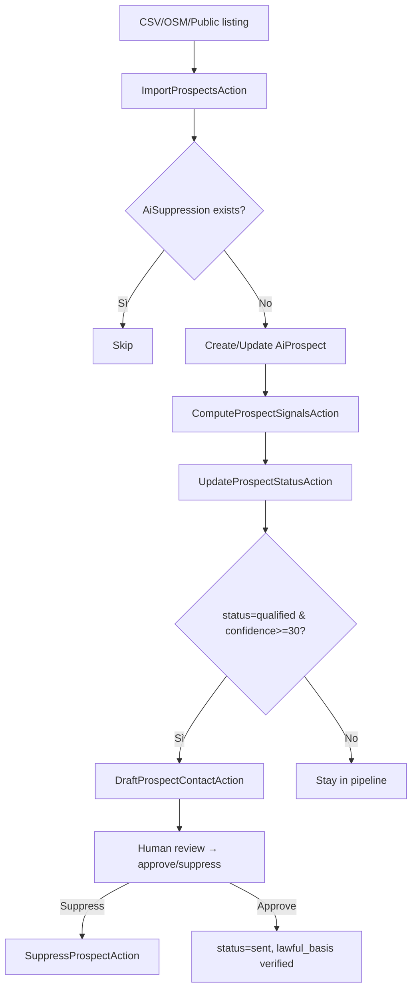

# AiProspect Pipeline — Client Research & Acquisition

Pipeline end-to-end per ricerca e acquisizione nuovi clienti B2B nel modulo AI,
ispirata a **closer-skill** (11 skills: prospector, researcher, follow-up, sales-coach,
contract-writer, pipeline, scheduler, proposal-writer, win-back, forecaster, record-keeper)
e **Sellbird** (discover → signals → enrich → verify → send → handle replies).

## Obiettivo

Realizzare nel modulo AI riusabile la pipeline:
**discover/import → normalize/dedupe → evidence & signals → score → brief/draft → revisione umana → suppression**

## Principi architetturali (da closer-skill + Sellbird)

| Principio | Implementazione |
|---|---|
| **Deterministic identity** | `public_id = sha256(domain)` — stesso prospect, stesso ID, ovunque |
| **Workspace isolation** | `workspace_id` separa prospect di ogni cliente/tenant |
| **Idempotent import** | Re-import CSV/OSM non duplica, aggiorna source/timestamp |
| **No auto-send** | Bozze create, mai inviate: approvazione umana per ogni messaggio |
| **Suppression persists** | Do-not-contact sopravvive a re-import |
| **Evidence-based signals** | Ogni segnale ha `source`, `quality_source`, `confidence`, `score`, `breakdown` |
| **Lawful basis required** | `lawful_basis` obbligatorio su ogni bozza (legitimate_interest/consent) |

## Modelli

### AiProspect
Core entity. Campi chiave:
- `public_id` (uuid deterministico = `sha256(domain)`)
- `workspace_id` (isolation)
- `status` enum: `new → qualified → contacted → cold_lost | won`
- `source`, `source_url`, `source_at` (provenienza dati)
- `raw_data` (original row per audit)

### AiProspectSignal
Prove puntuali per una prospect:
- `source`: csv | osm | public_listing | website_signals | email_verification
- `quality_source`: high | medium | low
- `confidence`: 0-100 (quanto fidarsi della fonte)
- `score`: 0-100 (segnale positivo per ICP fit)
- `breakdown`: array spiegabile per campo

### AiProspectDraft
Brief e bozza primo contatto:
- `status`: draft → pending_review → reviewed → sent → suppressed
- `lawful_basis`: {basis, evidence} — sempre presente
- `personalization`: icebreaker, hooks, company_data
- MAI auto-send: `sent_at` popolato solo dopo revisione umana

### AiSuppression
Do-not-contact persistente:
- `public_id` + `workspace_id` = chiave logica
- `reason`: do_not_contact | unsubscribed | bounced | invalid_email | gdpr_request
- Rispettata da `ImportProspectsAction` anche su re-import

## Actions (Queueable)

| Action | Responsabilità |
|---|---|
| `ImportProspectsAction` | Import idempotente CSV/OSM/listing → AiProspect + AiSuppression check |
| `ComputeProspectSignalsAction` | Calcolo segnali da fonte (website_signals, email_verification, ecc.) |
| `UpdateProspectStatusAction` | Transizione stato NEW→QUALIFIED→CONTACTED basata su confidence/score |
| `DraftProspectContactAction` | Genera bozza se confidence ≥ 30; legge lawful_basis, niente auto-send |
| `SuppressProspectAction` | Crea suppression record + aggiorna prospect.status = cold_lost |

## Flusso operativo

## Sicurezza & Compliance (da Sellbird)

- Niente scraping siti privati/login
- Niente email dedotte (solo verificate)
- Niente dati personali non necessari
- Ogni invio richiede approvazione umana esplicita
- Suppression list include GDPR/unsubscribed/bounced
- OSM Overpass usato solo per dati pubblici non commerciali ricorrenti

## Testing

Pest tests senza DB reale (schema-only):
- `AiProspectTest`: deterministic_id, scope_by_workspace, relationship, fills
- `ImportProspectsTest`: idempotent import, skip suppressed, skip empty domain

## Files creati

### Models
- `app/Models/AiProspect.php`
- `app/Models/AiProspectSignal.php`
- `app/Models/AiProspectDraft.php`
- `app/Models/AiSuppression.php`

### Enums
- `app/Enums/AiProspectStatusEnum.php`
- `app/Enums/AiProspectSignalSourceEnum.php`
- `app/Enums/AiProspectDraftStatusEnum.php`
- `app/Enums/AiSuppressionReasonEnum.php`

### Actions
- `app/Actions/ImportProspectsAction.php`
- `app/Actions/ComputeProspectSignalsAction.php`
- `app/Actions/UpdateProspectStatusAction.php`
- `app/Actions/DraftProspectContactAction.php`
- `app/Actions/SuppressProspectAction.php`

### Migrations
- `database/migrations/2026_11_27_000001_create_ai_prospects_table.php`
- `database/migrations/2026_11_27_000002_create_ai_prospect_signals_table.php`
- `database/migrations/2026_11_27_000003_create_ai_prospect_drafts_table.php`
- `database/migrations/2026_11_27_000004_create_ai_suppressions_table.php`

### Tests
- `tests/Unit/Models/AiProspectTest.php`
- `tests/Unit/Actions/Prospect/ImportProspectsTest.php`

## Riferimenti esterni

- [closer-skill](https://github.com/jakeschincariol/closer-skill) — 11 skills sales pipeline
- [Sellbird](https://github.com/ethanplusai/sellbird) — open-source outreach platform